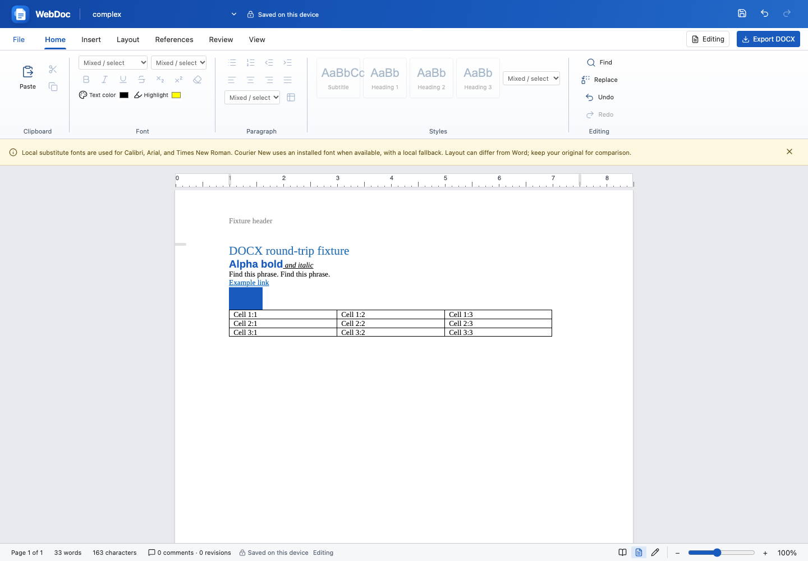

<div align="center">
  
  <h1>WebDoc</h1>
  <p><strong>Your documents. Your browser. Your workspace.</strong></p>
  <p>A polished document editor for writing, formatting, and working with DOCX files—without uploading your documents.</p>
  <p><a href="https://webdoc-studio.netlify.app"><strong>Open WebDoc ↗</strong></a> · <a href="#get-started">Run locally</a> · <a href="docs/AUTOMATION_API.md">Automation API</a></p>
</div>



## A familiar place to write

- **Word-style workspace:** organized ribbon, document styles, numbered ruler, page navigation, and zoom.
- **Real editing:** text and paragraph formatting, tables, images, hyperlinks, search/replace, undo, and redo.
- **Document tools:** margins, orientation, columns, headers, footers, page numbers, notes, comments, and tracked edits.
- **Local-first saving:** continuous browser drafts, document history, and optional local DOCX overwrite every 30 seconds.
- **Portable documents:** DOCX import/export and full-document print preparation.
- **Built for future integrations:** structured editing commands and a local audio adapter. No AI provider is connected yet.

## Get started

```sh
npm ci
npm run dev
```

Requires Node.js 22.12+ and npm. Open the address printed in your terminal.

```sh
npm run build    # Production frontend in dist/
npm run preview  # Preview the build
npm run lint     # Code checks
npm run api:check # Verify structured command schemas
```

## Work with a document

1. Choose **File → Open / Import DOCX**, or start a new document.
2. Select text and use the ribbon to format it. Use **Find** or **Replace** to navigate and revise.
3. Your browser draft saves continuously. To also save to disk, choose **File → Choose autosave file**.
4. Press **Ctrl/Cmd+S** to save immediately, or **Export DOCX** to download a copy.
5. Reopen drafts from **File → Document history**. Removed drafts can be restored or permanently deleted.

A local save destination is disconnected when you switch documents or reload. Browser file overwrite requires Chrome/Edge or another supporting browser; other browsers can still save drafts and download DOCX files. Browser data is specific to the current device, profile, and site address. Keep exported copies as backups.

## Compatibility

WebDoc preserves the original bytes when exporting an untouched imported document. Edited files are serialized as editable DOCX. Complex layouts, unavailable fonts, advanced drawings, and some fields can differ from desktop Word; keep the original when working with important documents. Unsupported tools are identified in the interface. WebDoc does not claim complete Microsoft Word compatibility.

## For developers

The application is a React frontend with browser-based document processing and IndexedDB persistence. It needs no document-processing backend. Deploy the contents of `dist/` to a static HTTPS host; Netlify configuration is included.

The [automation guide](docs/AUTOMATION_API.md) documents command discovery, structured page reads, validated edits, revision guards, undo boundaries, and future model/audio integration.
